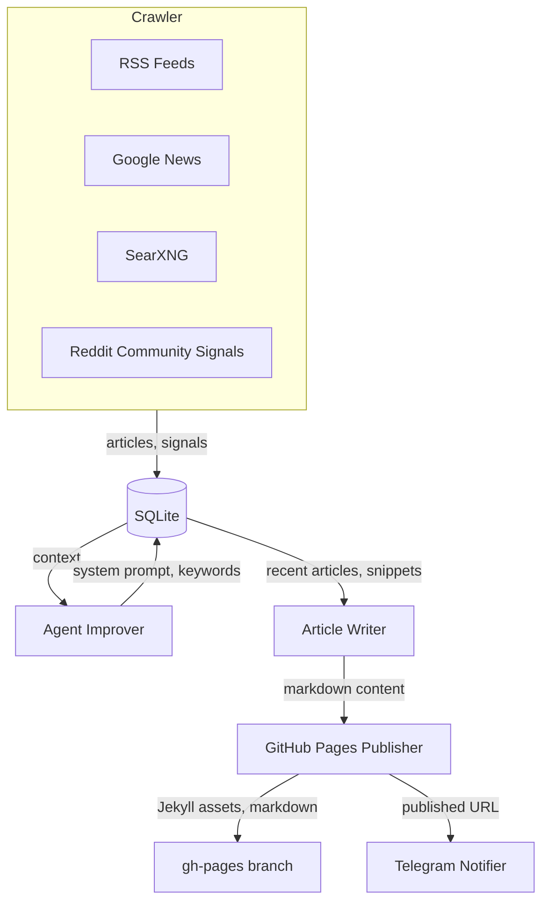
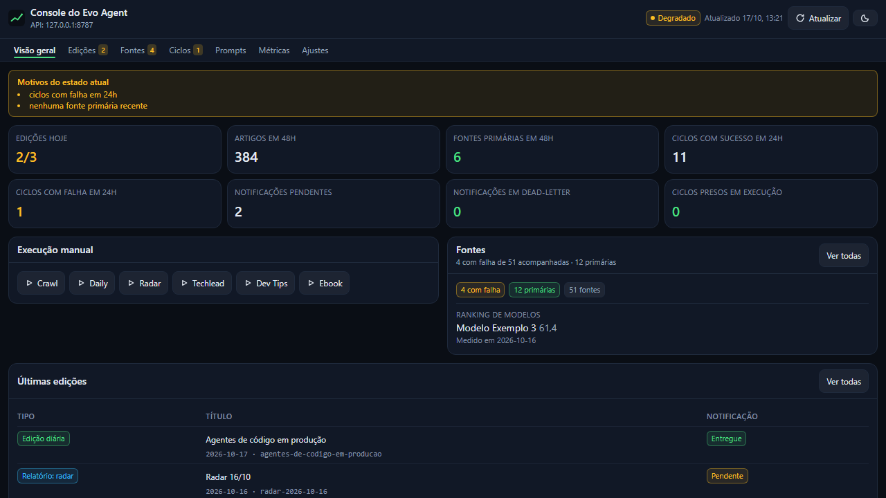

# evo-agent

[](https://www.typescriptlang.org/)
[](https://nodejs.org/)
[](https://biomejs.dev/)

Agente de publicação com IA que se auto-aprimora. Coleta fontes de IA e desenvolvimento, aprende com as tendências e gera artigos técnicos em pt-BR publicados no GitHub Pages, avisando via Telegram. Um console desktop (Tauri) acompanha saúde, edições e ciclos pela API REST do agente.

---

## Arquitetura



## Funcionalidades

- **Coleta multi-fonte**: RSS/HTML, busca por palavra-chave no Google News, SearXNG para Reddit/X.com, Hacker News, TabNews, GitHub Trending, Hugging Face Daily Papers (ranqueado por votos), modelos em alta no Hugging Face, lançamentos de modelos dos grandes laboratórios (catálogo OpenRouter, últimos 14 dias), release notes de coding agents (Claude Code, Codex, Gemini CLI, Copilot CLI, Cursor, MCP) e análise de sinais da comunidade no Reddit. Itens de feed com mais de 14 dias são ignorados e corpos Atom preenchem snippets vazios
- **Ciclo de auto-aprimoramento**: o system prompt e as palavras-chave de busca evoluem a partir do conteúdo ingerido
- **Orquestração confiável**: ciclos sobrepostos são pulados e cada execução fica registrada no SQLite
- **Pontuação editorial**: recência, engajamento, autoridade da fonte, diversidade e evidência entre fontes definem a seleção
- **Proveniência da evidência**: cada destaque selecionado preserva URL da fonte, título e trecho de apoio
- **Auto-aprimoramento com guarda**: candidatos de prompt são pontuados, versionados, promovidos só sem regressão e podem sofrer rollback
- **Geração de artigos**: três edições diárias longas (≥5 assuntos cada, sem repetir fontes no dia) e relatórios semanais/periódicos em pt-BR via LLM, com evidência ampliada de Reddit/comunidade quando disponível
- **Ebook vivo**: manual semanal e refinável de desenvolvimento assistido por IA, publicado no GitHub Pages
- **Publicação atômica no GitHub Pages**: artigo, layouts e índices entram em um único commit
- **Páginas descobríveis**: URL canônica, metadados Open Graph/Twitter, feed Atom e sitemap em toda página publicada
- **Escape por construção**: títulos e resumos coletados são escapados em HTML nos layouts Jekyll e achatados no front matter YAML
- **Outbox do Telegram**: entregas falhas são retentadas com backoff exponencial e isoladas em dead-letter; o job horário `CRAWL` drena a fila em produção, e avisos não entregues em 24h são suprimidos em vez de enviados atrasados
- **Saúde operacional**: logs estruturados, métricas persistentes, alertas de fonte primária e um comando de health legível por máquina
- **Fallback Playwright stealth**: busca automática via navegador quando fontes RSS respondem 403/429

## Requisitos

- Node.js 22 ou superior (a CI usa 22; o Dockerfile usa a imagem `mcr.microsoft.com/playwright:v1.60.0-noble`)
- npm (o repositório usa `package-lock.json`)
- Toolchain nativa para compilar `better-sqlite3` (compilador C/C++ e Python 3), caso não haja binário pré-compilado para a plataforma
- Opcional, só para o console desktop: Rust estável e as dependências do Tauri 2 (ver [`desktop/README.md`](desktop/README.md))

## Instalação

```bash
git clone git@github.com:juninmd/evo-agent.git
cd evo-agent
cp .env.example .env
# Edite o .env com suas credenciais
npm ci
npm run build
```

Use `npm ci` sem `--legacy-peer-deps`: com a flag, o peer `zod` exigido por `@ai-sdk/provider-utils` não é instalado e o processo compilado falha ao iniciar com `ERR_MODULE_NOT_FOUND`.

`@juninmd/digest-kit` é um pacote público no npm: não é preciso token de registry para instalar nem para construir a imagem.

## Configuração

As variáveis vêm do ambiente ou de um `.env` na raiz (use `.env.example` como modelo). Nunca commite valores reais.

| Variável | Obrigatória | Padrão | Descrição |
|---|---|---|---|
| `LITELLM_API_BASE` | Não | `http://litellm.ai.svc.cluster.local:4000/v1` | URL base do LiteLLM; fora do cluster, defina para o seu gateway (ex.: `http://localhost:4000/v1`) |
| `LITELLM_API_KEY` | Não | `no-key` | Chave de API do LiteLLM |
| `LITELLM_MODEL` | Não | `cloud/auto` | Modelo primário; `cloud/auto` é a cadeia do LiteLLM que decide o provider |
| `LITELLM_FALLBACK_MODELS` | Não | `cloud/auto` | Modelos de fallback separados por vírgula, usados se o primário falhar, estourar o tempo ou vier vazio |
| `LITELLM_MAX_OUTPUT_TOKENS` | Não | `12000` | Máximo de tokens de saída por requisição |
| `LITELLM_TIMEOUT_MS` | Não | `300000` | Timeout da requisição ao LiteLLM, em milissegundos |
| `TELEGRAM_BOT_TOKEN` | Sim | — | Token da Bot API do Telegram |
| `TELEGRAM_CHAT_ID` | Sim | — | ID do chat/grupo de destino no Telegram |
| `GITHUB_TOKEN` | Sim | — | PAT do GitHub com escrita no repositório |
| `GITHUB_OWNER` | Sim | — | Usuário ou organização no GitHub |
| `GITHUB_REPO` | Sim | — | Nome do repositório do Pages |
| `GITHUB_BRANCH` | Não | `gh-pages` | Branch de destino do conteúdo publicado |
| `CRAWL_INTERVAL_MINUTES` | Não | `40` | Frequência do ciclo de aprendizado no modo daemon |
| `ARTICLE_CRON` | Não | `0 8,13,18 * * *` | Cron das edições diárias (uma edição por horário) |
| `MODEL_ALERT_CRON` | Não | `*/30 * * * *` | Cron do alerta de novos LLMs (catálogo OpenRouter, grandes fornecedores, Telegram) |
| `DAILY_EDITIONS` | Não | `3` | Edições publicadas por dia; uma varredura às 22h preenche horários perdidos |
| `SEARXNG_URL` | Não | `http://searxng.searxng.svc.cluster.local` | URL da instância SearXNG |
| `API_HOST` | Não | `127.0.0.1` | Endereço de bind do `RUN_MODE=API` |
| `API_PORT` | Não | `8787` | Porta do `RUN_MODE=API` |
| `API_TOKEN` | Só `API` | — | Bearer token de `/api/v1`; a API se recusa a iniciar sem ele |
| `API_ALLOW_RUNS` | Não | `false` | Habilita `POST /api/v1/runs` |
| `API_CORS_ORIGINS` | Não | — | Origens de navegador permitidas, separadas por vírgula |
| `RADAR_CRON` | Não | `0 21 * * *` | Cron da edição Radar |
| `REDDIT_COMMENTS_ENABLED` | Não | `false` | Busca threads de comentários do Reddit; desligado porque o `.json` do post responde 403 em IPs de datacenter e gasta o orçamento compartilhado por IP |
| `HF_API_KEY` | Não | — | Token do Hugging Face para a marcação de entidades com GLiNER; vazio desabilita |
| `GLINER_MODEL` | Não | `urchade/gliner_multi-v2.1` | Modelo GLiNER usado quando `HF_API_KEY` está definida |
| `BACKFILL_START` / `BACKFILL_END` | Não | — | Intervalo de dias do `npm run backfill:articles` quando não passado como argumento |
| `OPENCODE_API_KEY` / `OPENCODE_MODEL` | Não | — | Aliases legados de `LITELLM_API_KEY` / `LITELLM_MODEL` |
| `TZ` | Não | `America/Sao_Paulo` | Fuso de todos os crons e da chave do dia da edição diária |
| `LOG_LEVEL` | Não | `info` | Verbosidade dos logs (`debug`, `info`, `warn`, `error`) |
| `LOG_FORMAT` | Não | `json` | Logs estruturados `json` ou saída local `text` |
| `DB_PATH` | Não | `data/knowledge.db` | Caminho do banco SQLite |

## Modos de execução

Defina `RUN_MODE` para controlar a execução (`npm start -- --help` imprime esta lista):

| Modo | Comportamento |
|---|---|
| `DAEMON` (padrão) | Roda o ciclo de aprendizado na hora e agenda via cron coleta, edições diárias e relatório semanal |
| `CRAWL` | Um ciclo de coleta + aprimoramento e sai |
| `DAILY` | Gera e publica um artigo diário (preenche o orçamento de edições do dia um horário por vez) e sai |
| `DAILY_SWEEP` | Publica o que falta do orçamento de edições de hoje, recuperando um horário que falhou antes; não faz nada se o dia está completo |
| `RADAR` | Publica o radar entre fontes (tabelas determinísticas mais uma leitura escrita pelo modelo, sem portão editorial) e sai |
| `TECHLEAD` | Publica o digest para tech leads e sai |
| `DEV_TIPS` | Transforma as release notes da semana de Claude Code, VS Code e OpenCode em dicas práticas (o que mudou, como usar, boa prática), publicadas como `devtips-<data>`, e sai; falha sem candidatos e cai para um ranking quando a saída do modelo cita algo fora do material |
| `WEEKLY` | Gera e publica um artigo semanal e sai |
| `BIWEEKLY` | Gera e publica um relatório quinzenal e sai |
| `MONTHLY` | Gera e publica um relatório mensal e sai |
| `BIMONTHLY` | Gera e publica um relatório bimestral e sai |
| `SEMESTER` | Gera e publica um relatório semestral e sai |
| `EBOOK` | Refina e publica o manual vivo de desenvolvimento assistido por IA e sai |
| `MODEL_ALERTS` | Consulta o catálogo OpenRouter uma vez e envia um alerta no Telegram por novo LLM de grande fornecedor, e sai (precisa só das credenciais do Telegram; a primeira execução grava a linha de base em silêncio) |
| `API` | Serve a API REST somente leitura consumida pelo console desktop (`docs/API.md`); precisa só de `API_TOKEN` |

## Uso

```bash
npm run dev                    # modo watch com tsx
npm start                      # roda a saída compilada (RUN_MODE=DAEMON por padrão)
RUN_MODE=CRAWL npm start       # um ciclo de coleta e sai
npm run health                 # emite o JSON de saúde operacional
npm run prompt:rollback        # restaura o system prompt promovido anterior
npm run edition -- list        # busca, reenfileira, retrata e repontua edições publicadas
npm run backfill:articles -- 2026-06-01 2026-06-11 # publica edições históricas sem spam no Telegram
npm run smoke:reddit-comments  # testa o coletor de sinais do Reddit com banco isolado
```

Saídas reais de `--help` e `npm run health` (banco vazio) estão em [`docs/terminal.txt`](docs/terminal.txt). Em banco vazio o health responde `critical`, o que é esperado: ainda não há ciclo nem artigo.

## Testes, lint e build

```bash
npm test                  # vitest run (suíte do agente)
npm run test:coverage     # testes com os pisos de cobertura do repositório
npm run benchmark:editorial # corpus determinístico de regressão editorial
npm run lint              # Biome (biome check src/)
npm run lint:fix          # corrige o que o Biome corrige sozinho
npm run build             # tsc + cópia de src/publisher/assets para dist/
```

O console desktop tem pacote e gate próprios (ver abaixo).

## Console desktop

`desktop/` é um app Tauri 2 + React 19 + Tailwind v4 que lê a API REST do agente: saúde, edições publicadas com a evidência preservada, saúde das fontes, histórico de ciclos, versões de prompt e métricas, além de execuções de ciclo sob demanda (opcional). O token fica no processo Rust e nunca chega ao webview.

```bash
RUN_MODE=API API_TOKEN=<segredo> npm start   # na raiz do repositório
cd desktop && npm install && npm run tauri dev
```

### Screenshot



Os prints em [`docs/prints/`](docs/prints/) são regenerados pelo `npm run e2e` do `desktop/`; esta captura não foi refeita nesta atualização de documentação.

Veja [`desktop/README.md`](desktop/README.md) para o app e [`docs/API.md`](docs/API.md) para o contrato REST.

## Estrutura do projeto

```
src/
  api/                  # RUN_MODE=API: servidor node:http, auth, rotas e disparo de execuções
  index.ts              # Ponto de entrada, agendamento cron, modos de execução
  config.ts             # Leitura do ambiente, validação, config congelada
  crawler/
    index.ts            # RSS, Google News, SearXNG, HN/TabNews e crawlAll
    agent-sources.ts    # Releases de coding agents, SDKs de agentes, feeds de praticantes
    feed-items.ts       # Janela de recência, seleção mais novo primeiro, fallback de resumo
    hf-papers.ts        # Hugging Face Daily Papers ranqueado por votos
    model-launches.ts   # Modelos em alta no HF + lançamentos de modelos (OpenRouter)
    reddit.ts           # Ritmo, rate limit e sinais da comunidade do Reddit
    reddit-smoke.ts     # Smoke test isolado dos sinais do Reddit
  knowledge/
    store.ts            # Persistência SQLite (artigos, snippets, estado, log de publicação)
  agent/
    improver.ts         # Auto-aprimoramento: atualiza prompt e palavras-chave a partir das fontes recentes
    writer.ts           # Geração de artigos e relatórios semanais via LLM
    ebook.ts            # Refino do manual vivo
    editorial-renderer.ts # Renderização determinística de artigos e citações
    prompt-policy.ts    # Política de promoção e rollback de prompts
  newspaper/
    edition.ts          # Baldes do radar + leitura -> manchete, editorias, matérias
    images.ts           # URLs de imagem de cartão a partir de ids GitHub/Hub validados (allowlist de hosts)
    inline.ts           # Parser da leitura e markdown inline escapado
    render.ts           # Página HTML standalone (documento do site ou fragmento embutível)
    styles.ts           # CSS do jornal com tokens claro/escuro
  publisher/
    github.ts           # Transação atômica na API do GitHub e publicação
    site-renderer.ts    # Scaffold Jekyll, layouts, CSS e renderização dos índices
  notifier/
    telegram.ts         # Notificações pela Bot API do Telegram
    outbox.ts           # Política de retry e dead-letter
  observability/
    health.ts           # Avaliação de saúde operacional
  utils/
    ai.ts               # Wrapper do cliente LiteLLM para geração de texto
    logger.ts           # Níveis de log com timestamp via console
```

## Site publicado

Os artigos ficam em `https://<GITHUB_OWNER>.github.io/<GITHUB_REPO>/` com:

- Alternância de tema claro/escuro (persistida em `localStorage`)
- Arquivo de artigos agrupado por ano e mês
- Seção de relatórios semanais
- Edição diária do jornal em `jornal/<YYYY-MM-DD>.html` ("Gazeta dos Agentes"), publicada no mesmo commit do radar e linkada a partir dele: manchete, TL;DR, uma editoria por balde do radar e imagens de cartão derivadas de URLs do GitHub e do Hugging Face (sem raspar páginas)
- Botão de download do Markdown por artigo
- Tipografia responsiva (Source Serif 4 no corpo, IBM Plex Mono no código, IBM Plex Sans na UI)

## Gates de CI

| Workflow | Job | O que checa |
|---|---|---|
| `ci.yml` | `test` | Node 22: `npm ci --legacy-peer-deps`, lint (Biome), build, `npm test`, `benchmark:editorial`, `test:coverage` e `npm audit --omit=dev --audit-level=moderate` |
| `ci.yml` | `desktop` | Em `desktop/`: lint (`tsc --noEmit` + Biome), `npm test`, build, `npm run e2e` (Playwright) e `npm audit` (não bloqueante) |
| `ci.yml` | `desktop-rust` | Em `desktop/src-tauri`: `cargo fmt --check`, `cargo clippy -D warnings` e `cargo test --locked` |
| `ci.yml` | `gitleaks` | Varredura de segredos no histórico completo |
| `docker.yml` | build | Constrói e publica `ghcr.io/juninmd/evo-agent` pelo workflow reutilizável `juninmd/base-actions` (push na `main`) |
| `security.yml` | scan | Scan de segurança pelo workflow reutilizável `juninmd/base-actions` (push na `main` e cron semanal) |

## Deploy

Imagem Docker publicada em `ghcr.io/juninmd/evo-agent:latest`. Os manifestos Kubernetes ficam em um repositório separado, `app-charts/evo-agent/`. Segredos são injetados pelo ambiente — nunca commite `.env` nem credenciais neste repositório.

## Qualidade de código (SonarQube Cloud)

O `sonar-project.properties` configura análise do SonarQube Cloud via CI, com cobertura (`coverage/lcov.info` gerado por `npm run test:coverage`). O passo de scan na CI ainda não está habilitado; antes de adicioná-lo:

1. No SonarQube Cloud, crie o projeto `juninmd_evo-agent` na organização `juninmd` (público).
2. No projeto, **Administration → Analysis Method**: desligue **Automatic Analysis** (conflita com a análise via CI).
3. Gere um token e salve como secret do repositório `SONAR_TOKEN`.

## Segurança

- `.env` fora do controle de versão
- Tokens nunca são logados nem expostos
- Sandbox do navegador habilitado (sem `--disable-web-security`)
- Handlers de sinal fecham o SQLite com segurança no shutdown
- Conteúdo dos artigos envolvido em `` para evitar injeção de Liquid no Jekyll

Detalhes operacionais e checagens no estilo SLO estão em [`docs/OPERATIONS.md`](docs/OPERATIONS.md).
