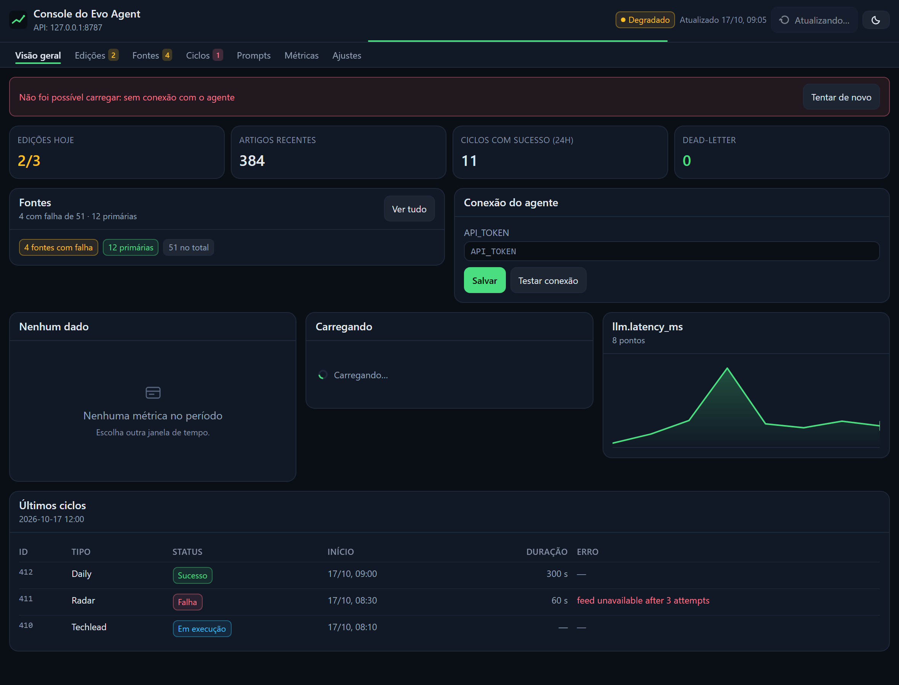
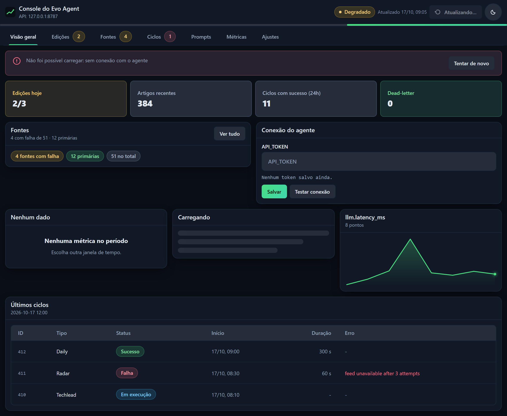

# Migração do console para `@juninmd/sonido@2.5.0`

O renderer do `desktop/` (React 19 + Tailwind v4) passou a usar os componentes do
Sonido **sem clonar nenhum componente local** e sem pasta `legacy/`. As telas
continuam falando o vocabulário do console (`Tone` `ok/warn/info`, `message/hint`,
`fill`), e a ponte `--sn-*` mantém a identidade visual: fundo `#0a0e15`, acento
verde `#4ade80` (claro: `#15803d`), raio de 12 px e corpo de 12 px.

## Antes / depois

| Antes (`origin/main`) | Depois (`feat/sonido-design-system`) |
| --------------------- | ------------------------------------ |
|    |                 |

As duas capturas são da mesma composição (cabeçalho, abas com atenção, erro,
grade de `StatTile`, card de fontes, formulário, estado vazio, skeleton,
sparkline e tabela de ciclos) com dados fictícios, 1180×900 @2x, página inteira.
O "antes" veio de um checkout temporário de `origin/main` em
`%TEMP%/opencode/before-evo-agent` (porta 5338); o "depois" veio desta árvore
(porta 5328). Os harnesses eram efêmeros e foram apagados antes do commit; não
existe `docs/sonido-migration/legacy/` nem `preview.*` versionado.

## Componentes trocados

| Primitivo local | Componente do Sonido | Arquivos |
| --------------- | -------------------- | -------- |
| `.evo-btn` / `.evo-btn-primary` | `Button` (`secondary`/`primary`, `sm`/`icon`) | `AppHeader`, `ErrorBanner`, `CopyButton`, `RunPanel`, `OverviewTab`, `PromptsTab`, `SettingsTab`, `EditionDetailPanel` |
| `Badge`, `StatusPill` | `Badge` (`appearance="soft"`, `dot`) | `Badge.tsx`, `StatusPill.tsx` e consumidores |
| `Card` (`.evo-card`) | `Card` + `CardHeader` + `CardBody` | `Card.tsx`, `EditionDetailPanel.tsx` |
| `EmptyState` | `EmptyState` | `EmptyState.tsx` |
| `Skeleton` (spinner) | `Skeleton` (`rows={3}`) | `Skeleton.tsx` |
| `StatTile` | `StatTile` | `StatTile.tsx` |
| `Sparkline` (SVG próprio) | `Sparkline` + `useSize` | `Sparkline.tsx` |
| `TabBar` | `Tabs` (`underline`, `idPrefix="aba"`) | `TabBar.tsx` |
| tabelas manuais | `DataTable` | `CycleTable.tsx`, `EditionTable.tsx`, `PromptsTab`, `SourcesTab` |
| — (não havia) | `Toast` + `ToastProvider` | `main.tsx`, `CopyButton`, `SettingsTab` |
| `input.evo-field` | `TextField` | `SettingsTab` |
| `select.evo-field` | `Select` (compacto) | `FilterSelect.tsx` (Ciclos, Edições, Métricas, Fontes) |
| `input[type=checkbox]` | `Checkbox` | `SourcesTab` |
| banners de erro/aviso | `Alert` | `ErrorBanner`, `OverviewTab`, `App`, `EditionDetailPanel` |
| botão "Limpar token" | `ConfirmButton` (`appearance="inline"`) | `SettingsTab` |
| barra de atividade | `ProgressBar` (indeterminada, `sm`) | `AppHeader` |

São 16 componentes distintos do pacote em uso. `TabBar` continua existindo como
adaptador de props (ids `aba-*`, badges de atenção), não como reimplementação.

## Ponte de tokens e tema

- `desktop/src/main.tsx` importa `@juninmd/sonido/styles.css` **uma vez**, antes
  de `styles.css`.
- `desktop/src/styles.css` liga `--sn-*` aos tokens do console (cor, tipografia,
  raio, foco, `--sn-hit-min: 24px`). O bloco tem especificidade
  `:root:root[data-theme]` para vencer os temas do pacote independentemente da
  ordem do bundle.
- `desktop/src/lib/theme.ts` escreve `data-skin` (console) e `data-theme`
  (`dark`/`light`, vocabulário do Sonido) no mesmo `applyTheme`.
- `index.html` já nasce com `data-theme="dark"`.
- Ajustes de densidade que o CSS sem `@layer` do pacote impede de fazer por
  utilitário ficam explícitos em `styles.css` (`.evo-card.sn-card { gap: 0 }`,
  `.evo-empty.sn-empty`, badge dentro da aba).

## Comandos e resultados

Gerenciador canônico: **npm** (`desktop/package-lock.json`; CI usa `npm ci`).

| Comando | Resultado |
| ------- | --------- |
| `npm install @juninmd/sonido@^2.5.0` (em `desktop/`) | árvore em `2.5.0`; lock atualizado (só o pacote novo) |
| `npm run lint` | `tsc --noEmit` + `biome check src/`: 42 arquivos, 0 erros |
| `npm test` | 6 arquivos, **35/35** testes |
| `npm run build` | Vite 8.3.4: JS 283,76 kB (era 275,42 kB), CSS 165,16 kB (era 23,29 kB) |
| `npm run e2e` | **12/12** testes Chromium (o teste de tema claro agora também fixa `data-theme` e `--sn-color-accent`) |

`origin/main` no mesmo Windows 11 / Node 24.21 também está verde: lint (41
arquivos), 35 testes, build e 12/12 e2e. Não há falha exclusiva de Windows a
provar; o único vermelho visto foi o e2e completo rodando com quatro servidores
Vite concorrentes na máquina (timeout do `webServer`/primeira asserção), que
passou no rerun e também passa em `origin/main`.

## Lacunas e decisões

- **`DataTable`**: cobre Ciclos, Edições, Prompts e Fontes. A tabela de Métricas
  ficou local porque a linha selecionada muda de cor e o nome é um botão com
  `aria-pressed`; `DataTable` não expõe estado/classe por linha, e trocar por
  clique na linha perderia o toggle acessível.
- **`Tabs`**: `hasPanels` ficaria com `aria-controls` apontando para painéis que
  não existem (o console monta só a aba ativa), então foi omitido; o painel
  mantém `aria-labelledby="aba-<aba>"`.
- **`CardTitle`** do pacote renderiza `h3`; o console mantém `h2` no
  `CardHeader` para não pular nível de cabeçalho.
- **`Badge`** não tem tom `info`; o `info` do console mapeia para `aqua`.
- **`Sparkline`** desenha num viewBox fixo; a largura vem de `useSize` para não
  esticar o traço.
- **`Toast`** substituiu os avisos inline de copiar/salvar; erros continuam em
  `Alert`/`role="alert"`.
- `docs/prints/*.png` são regenerados por `npm run e2e`, mas ficaram fora deste
  PR para manter o escopo nas duas capturas da migração.
