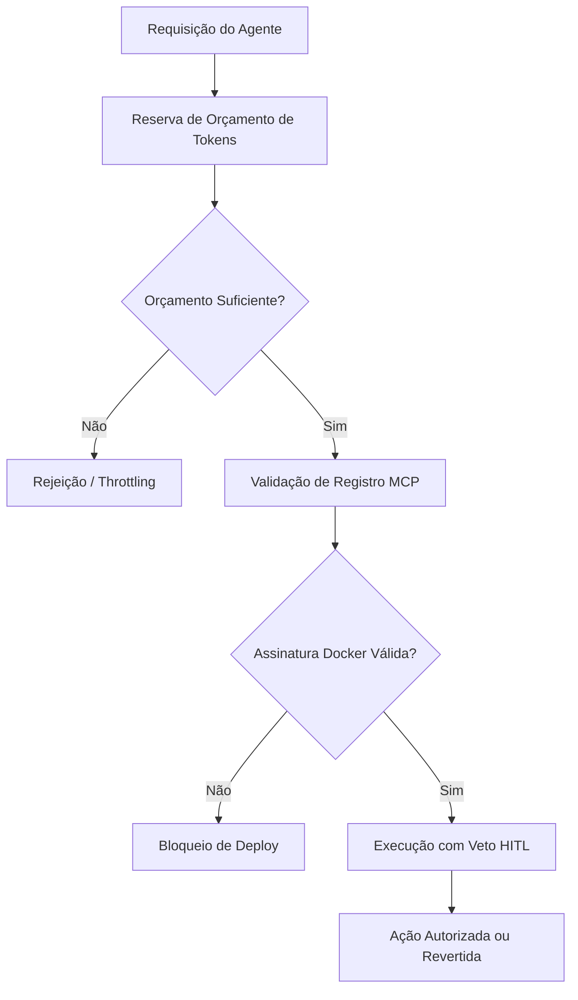


**Período:** 18/10/2026 a 01/11/2026

## Destaques do período

- **Intrinsic Distribution Matching**  
  Pesquisa sobre geração de imagem texto-para-um-shot e poucos passos, utilizando匹配 de distribuição (DMD) via diferenças de escopo para aproximar a distribuição gerada a uma referência, visando renderização fiel do prompt com poucas iterações de refinamento. [HF Daily Papers](https://huggingface.co/papers/2610.39633)

- **A-RSI: Adaptive Task Refresh para Auto-Melhoria Multimodal**  
  Método de auto-improvemento recursivo zero-dados que decide quando a experiência acumulada deixou de ser útil e introduz novas tarefas, abordando o ponto de quando atualizar a experiência, e não apenas o quê gerar. [HF Daily Papers](https://huggingface.co/papers/2610.38568)

- **Benchmark como Medida Empírica de Dificuldade**  
  Proposta de ver benchmarks como medida empírica sobre dificuldade, formalizando falhas de "desalinhamento de medida" e oferecendo lente para avaliar validade de conjuntos de teste. [HF Daily Papers](https://huggingface.co/papers/2610.29927)

- **AVTSE Streaming para Cenas Acústicas Reais**  
  Extração de falante alvo áudio-visual em streaming para aplicações de baixa latência, abordando gaps de benchmarks que fixam número de falantes e ignoram interferência próxima/distante, reverberação e ruído súbito. [HF Daily Papers](https://huggingface.co/papers/2610.32749)

- **Look Only When Needed: Roteamento Visual Guiado por Certificado**  
  Técnica para DVLMs (Diffusion VLMs) que processa tokens visuais apenas quando necessário, reduzindo custo de decodificação já que tokens visuais compõem 89-97% da entrada em benchmarks estudados. [HF Daily Papers](https://huggingface.co/papers/2610.36671)

- **Rollback: Retrocesso de Experiência em Modelos Mundiais**  
  World models action-conditioned que permitem backtracking de experiência para melhorar políticas de robótica, explorando capacidade que ambientes físicos não possuem naturalmente. [HF Daily Papers](https://huggingface.co/papers/2610.36068)

- **ChatGPT e Codex: Fusão de Limites de Uso**  
  OpenAI uniu limites de uso entre ChatGPT e Codex, gerando preocupação de usuários Pro que separavam quotas de "thinking" para pesquisa e Codex para código. [Hacker News](https://help.openai.com/en/articles/20001625-understanding-chatgpt-and-codex-usage-limits)

- **Claude Code v2.1.316**  
  Adiciona variável `CLAUDE_CODE_DISABLE_ULTRATHINK` para desativar o keyword ultrathink, e orçamentos agrupados (pooled group budgets) no gateway de apps Claude via API de limites de gastos. [Claude Code Releases](https://github.com/anthropics/claude-code/releases/tag/v2.1.316)

- **Claude Code v2.1.314**  
  Introduz `permissions.blockWritesOutsideWorkingDirectories` para recusar escritas fora dos diretórios de trabalho em todo modo de permissão, e lista opcional de grupos IdP para upstreams do gateway de apps Claude. [Claude Code Releases](https://github.com/anthropics/claude-code/releases/tag/v2.1.314)

- **LangGraph 1.2.19 e SDK 0.4.11**  
  Correções de namespace de eventos de mensagens e ferramentas, retenção de `trace_policy` em payloads streamados, e retry com backoff em reconexões de `runs.wait`, `join` e `cancel`. [LangGraph Releases](https://github.com/langchain-ai/langgraph/releases/tag/1.2.19)

- **Microsoft Agent Framework .NET 1.27.0 e Python 1.24.0**  
  Correções consistentes de conversão de valores no .NET, validação de ferramentas de provedores de contexto no Python, e remoção do classificador Python 3.10. [Releases](https://github.com/microsoft/agent-framework/releases/tag/dotnet-1.27.0)

- **Vercel AI SDK: Múltiplos Pacotes (Topaz, Voyage, XAI, ZAI, Typesafe AI, Workflow)**  
  Suporte a promises e callbacks síncronos/assíncronos em configuração de chave de API e token, com resolução de credenciais por requisição autenticada; sandbox ganha `stat`, `listDirectory` e `deleteFile`. [Vercel AI SDK Releases](https://github.com/vercel/ai/releases/tag/%40ai-sdk%2Ftopaz%403.0.19)

- **OpenCode v2.2.5**  
  Atalhos para worktree e shell mode no composer, além de envio de citações a partir do popup de comentários. [OpenCode Releases](https://github.com/anomalyco/opencode/releases/tag/v2.2.5)

- **OpenCode v2.2.3 e v2.2.4**  
  Integração com Claude Code via `/connect`, terminais desktop persistentes que sobrevivem a reinicializações de servidor, e publicação de artefatos interativos. [OpenCode Releases v2.2.3](https://github.com/anomalyco/opencode/releases/tag/v2.2.3) [OpenCode Releases v2.2.4](https://github.com/anomalyco/opencode/releases/tag/v2.2.4)

- **Padrão de Reserva de Orçamento de Tokens (Token Budget Reservation)**  
  Padrão TypeScript que reserva orçamento de tokens pré-voo (não pós-contagem) usando `max_completion_tokens` para endpoints OpenAI/Azure compatíveis (série GPT-6), evitando rejeição de requisição e suporte a FinOps. [Code pattern](https://github.com/anomalyco/opencode/releases/tag/v2.2.5)

- **Padrão de Guardrail de Autorização de Agente (FIS Global / Anti-Hijack)**  
  Camada de autorização zero-trust para agentes financeiros com limites por transação/diários, veto humano obrigatório (HITL) para transições de auto-mode, e validação de registro MCP. [Code pattern](https://github.com/microsoft/agent-framework/releases/tag/dotnet-1.27.0)

- **Padrão de Verificação de Assinatura Docker com Cosign**  
  Validação de registro de servidores MCP com verificação de assinatura de imagem Docker via cosign/sigstore, prevenindo deploy de imagens não assinadas em harnesses Kubernetes. [Code pattern](https://github.com/microsoft/agent-framework/releases/tag/python-1.24.0)

- **OpenAI: Relatório de Segurança da Comunidade e Proteções para Adolescentes**  
  OpenAI amplia proteções contra violência no ChatGPT com intervenções mais precoces e novo compromisso de relato público de segurança. [OpenAI Blog](https://openai.com/index/community-safety-report-and-new-protections-for-teens)

- **OpenAI: Preferências de Treinamento de IA via robots.txt**  
  OpenAI passará a honrar sinal compartilhado de `robots.txt` para que operadores de sites comuniquem preferências de treinamento de IA a provedores participantes. [OpenAI Blog](https://openai.com/index/helping-websites-express-ai-training-preferences)

- **OpenAI: Detecção de Desalinhamento de Modelos de Fronteira**  
  Uso de monitoramento em camadas para detectar desalinhamento de modelos de fronteira e comportamento não autorizado de agentes, permitindo intervenção antes de incidentes se agravarem. [OpenAI Blog](https://openai.com/index/how-we-detect-frontier-model-misalignment)

- **GitHub: Controles de Plugin Empresarial e Defaults de Repositório**  
  Disponibilidade geral de defaults de plugin de repositório e controles gerenciados por empresa em VS Code, Copilot CLI e app GitHub Copilot, permitindo que repositórios confiáveis instalem e habilitem plugins padrão. [GitHub Changelog](https://github.blog/changelog/2026-10-28-repository-plugin-defaults-and-enterprise-plugin-controls-generally-available)

## Tendências

O período consolida uma mudança arquitetônica clara: modelos de difusão e VLMs estão deixando de processar entradas inteiras a cada passo, adotando roteamento seletivo (como o *certificate-guided visual routing*) e geração em poucos passos via *distribution matching*. Paralelamente, frameworks de agentes (LangGraph, OpenCode, Claude Code, Microsoft Agent Framework) convergem para controle determinista de execução — orçamento prévio de tokens, vetos humanos obrigatórios para transições de modo autônomo e verificação criptográfica de suprimentos (cosign) — tratando o agente não mais como um chat estendido, mas como um componente de sistema sujeito a políticas de segurança e FinOps.

Um fluxo recorrente conecta esses destaques: a necessidade de limitar o escopo de ação do agente antes da execução, seja reservando tokens, restringindo escritas a diretórios de trabalho ou exigindo assinatura de imagens. Isso reduz a superfície de ataque e evita estouros de custo ou contexto em loops multi-agente. Abaixo, a relação causal entre esses controles:

Por fim, a governança de dados de treinamento ganhou destaque com o OpenAI defendendo *fair use* e introduzindo sinais de preferência via `robots.txt`, enquanto equipes de segurança passaram a monitorar desalinhamento de modelos de fronteira e comportamento não autorizado de agentes. Isso sugere que, além da performance bruta, o diferencial competitivo dos próximos harnesses de IA estará na capacidade de comprovar conformidade, controlar custos por transação e manter trilhas de auditoria reproduzíveis de cada execução agente.

## Fontes e Referências

1. [Intrinsic Distribution Matching](https://huggingface.co/papers/2610.39633) — HF Daily Papers
2. [A-RSI: Adaptive Task Refresh for Zero-Data Multimodal Self-Improvement](https://huggingface.co/papers/2610.38568) — HF Daily Papers
3. [Your Benchmark Is an Empirical Measure Over Difficulty](https://huggingface.co/papers/2610.29927) — HF Daily Papers
4. [Efficient Streaming Audio-Visual Target Speaker Extraction for Real-World Acoustic Scenes](https://huggingface.co/papers/2610.32749) — HF Daily Papers
5. [Look Only When Needed: Certificate-Guided Visual Routing for Efficient Diffusion VLMs](https://huggingface.co/papers/2610.36671) — HF Daily Papers
6. [Rollback: Experience Backtracking in World Models for Policy Improvement](https://huggingface.co/papers/2610.36068) — HF Daily Papers
7. [ChatGPT and Codex usage limits merging](https://help.openai.com/en/articles/20001625-understanding-chatgpt-and-codex-usage-limits) — Hacker News
8. [v2.1.316](https://github.com/anthropics/claude-code/releases/tag/v2.1.316) — Claude Code Releases
9. [langgraph==1.2.19](https://github.com/langchain-ai/langgraph/releases/tag/1.2.19) — LangGraph Releases
10. [dotnet-1.27.0](https://github.com/microsoft/agent-framework/releases/tag/dotnet-1.27.0) — Microsoft Agent Framework Releases
11. [@ai-sdk/topaz@3.0.19](https://github.com/vercel/ai/releases/tag/%40ai-sdk%2Ftopaz%403.0.19) — Vercel AI SDK Releases
12. [python-1.24.0: Python: prepare 1.24.0 release for October 30 (#9847)](https://github.com/microsoft/agent-framework/releases/tag/python-1.24.0) — Microsoft Agent Framework Releases
13. [v2.1.314](https://github.com/anthropics/claude-code/releases/tag/v2.1.314) — Claude Code Releases
14. [Repository plugin defaults and enterprise plugin controls generally available](https://github.blog/changelog/2026-10-28-repository-plugin-defaults-and-enterprise-plugin-controls-generally-available) — GitHub Changelog
15. [v2.2.5](https://github.com/anomalyco/opencode/releases/tag/v2.2.5) — OpenCode Releases
16. [v2.2.4](https://github.com/anomalyco/opencode/releases/tag/v2.2.4) — OpenCode Releases
17. [v2.2.3](https://github.com/anomalyco/opencode/releases/tag/v2.2.3) — OpenCode Releases
18. [Community safety report and new protections for teens](https://openai.com/index/community-safety-report-and-new-protections-for-teens) — OpenAI Blog
19. [Making it easier for websites to express AI training preferences](https://openai.com/index/helping-websites-express-ai-training-preferences) — OpenAI Blog
20. [How we detect frontier model misalignment](https://openai.com/index/how-we-detect-frontier-model-misalignment) — OpenAI Blog

<!-- evo-agent model: cloud/auto -->


---
*Gerado por evo-agent - agente auto-aprimorante em 2026-11-01.*
