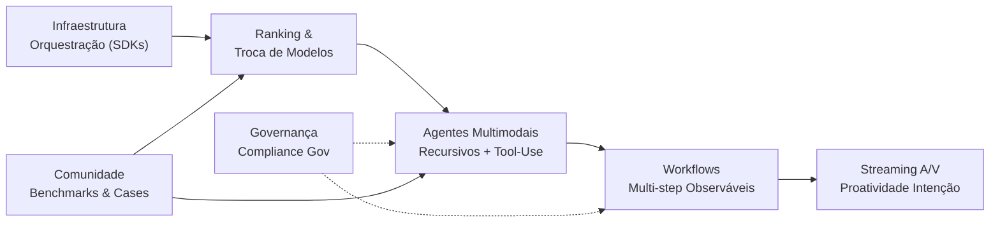


**Periodo:** 29/09/2026 a 29/10/2026

## Ranking de modelos e capacidades avançadas

- O ranking de inteligência divulgado pela Artificial Analysis em 28 de outubro de 2026 mostra Gemini 4 Carbon (High) assumindo a liderança com 59,4 pontos, enquanto DeepSeek V4.1 Flash 1017 (Max) lidera os pesos abertos com 32,5 pontos. As mudanças de posição incluem a queda de Claude Opus 5.5 (Max, Default Fallback) do primeiro para o segundo lugar, o deslocamento de GPT-6 Astra (Max) da segunda para a terceira posição e a presença de GPT-6.1 Sol (Max) no topo do top 10 (https://artificialanalysis.ai/models#intelligence#2026-10-28).

## Agentes multimodais com melhoria recursiva

- **[HF Daily Papers] The Trinity: Capability-Driven Recursive Self-Improvement for Multimodal Agents** (https://huggingface.co/papers/2610.36077): O artigo propõe o framework **The Trinity** para habilitar a auto-melhoria recursiva em agentes multimodais, decompondo o processo em três componentes co-evolutivos: geração de ambientes heterogêneos e verificáveis, iteração de políticas guiada por capacidades e avaliação contínua de desempenho. A abordagem ataca diretamente os gargalos de custo de construção de ambientes e a incapacidade de iteração manual acompanhar a diversidade de tarefas, permitindo que o agente expanda seu próprio currículo de treinamento. Experimentos demonstram que o ciclo recursivo melhora consistentemente a resolução de tarefas complexas sem supervisão humana densa a cada iteração.

## Ferramentas para agents de uso de tools

- Trajectory2Gym demonstra que trajetórias de uso bem‑sucedido de ferramentas nem sempre fornecem supervisão útil, pois podem omitir dependências multi‑passo ou incluir ações não justificadas pelo contexto observado no momento da decisão (https://huggingface.co/papers/2610.33568). Os autores identificam que a supervisão eficaz requer cobertura composicional, garantindo que as demonstrações cubram todos os sub‑comportamentos necessários para a tarefa. Essa constatação aponta para a necessidade de métricas de avaliação que julguem a completude composicional das trajetórias, em vez de apenas a sucessão final (https://huggingface.co/papers/2610.33568).

## Agentes proativos para intenção do usuário

- StreamVibe apresenta uma nova abordagem em que modelos de visão‑linguagem antecipam ações do usuário ao inferir intentos implícitos (ex.: “onde devo clicar?”) durante navegação em tempo real, atualizando continuamente o estado interno para refletir essas mudanças e superar a dependência de solicitações explícitas e a falta de sincronização de estado nas metodologias atuais【https://huggingface.co/papers/2610.34662】.

## Parcerias governamentais e compliance

- **Expansão da parceria com a GSA**: A Anthropic anunciou a expansão da parceria com a Agência de Serviços Gerais (GSA) dos EUA para disponibilizar o Claude em todos os níveis do governo federal. A iniciativa visa modernizar a entrega de serviços públicos, permitindo que agências utilizem IA generativa para tarefas administrativas e de atendimento ao cidadão, mantendo níveis rigorosos de segurança e compliance. Esta parceria representa um passo significativo na adoção responsável de IA no setor público americano, estabelecendo um precedente para outras agências federais. [Fonte](https://www.anthropic.com/news/expanding-partnership-gsa)

## Infraestrutura e orquestração de modelos

- **GitHub Agentic Workflows torna-se GA** – O projeto open‑source GitHub Next disponibiliza oficialmente os Agentic Workflows, permitindo automatizar tarefas de raciocínio como triagem de issues, análise de falhas em CI e atualizações de documentação. Essa capacidade reduz a intervenção manual e aumenta a confiabilidade dos pipelines de software [GitHub Blog](https://github.blog/changelog/2026-10-28-github-agentic-workflows-generally-available).  

- **Copilot Fusion suporta seleção de modelos locais** – Em pré‑visualização experimental, o Copilot Fusion agora pode rotear solicitações entre modelos on‑device e na nuvem, oferecendo flexibilidade na escolha de latência e privacidade de dados. Essa funcionalidade habilita equipes a escolherem o melhor trade‑off entre performance e segurança ao usar modelos de IA localmente [GitHub Blog](https://github.blog/changelog/2026-10-28-github-copilot-fusion-now-supports-selection-of-local-models).  

- **Automations compartilháveis do Copilot** – A API de Copilot Automations agora permite criar, versionar e compartilhar workflows AI entre equipes, unindo prompts, gatilhos e ferramentas em um único repositório. Isso simplifica a manutenção de pipelines personalizados e melhora a colaboração inter‑devs em projetos complexos [GitHub Blog](https://github.blog/changelog/2026-10-28-build-shared-workflows-for-your-team-with-copilot-automations).  

- **Inteligência do GitHub integra código, contexto e histórico** – O novo modelo de agentes leva em conta preferências, convenções de repositório, habilidades e instruções customizadas para propor alterações que alinhem com o fluxo de trabalho da equipe. Isso aumenta a precisão das recomendações de código, reduz erros e acelera revisões [GitHub Blog](https://github.blog/changelog/2026-10-28-github-intelligence-puts-your-code-context-and-history-to-work).

## LLM Agents e multi-step workflows

- **Multiscale Policy Optimization (MPO) para agentes LLM de longo prazo**  
  Os autores mostram que, ao interagir em ciclos completos, os valores críticos mudam principalmente entre os turnos, não entre os tokens. Ao apoiar a otimização em níveis de escalas, o MPO distribui créditos de forma mais granular entre tokens, melhorando a aprendizagem de tarefas com horizonte estendido. Esse trabalho abre caminho para agentes que tomam decisões complexas em ambientes com recompensas esparsas. <cite>[HF Daily Papers]</cite>  

- **Tool para manter Codex funcionando com a tampa do laptop fechada**  
  Um usuário desenvolveu um app de barra de menu que evita o superaquecimento do MacBook quando a tampa está fechada, permitindo que o Codex continue rodando enquanto o usuário transporta o aparelho. A solução não requer ferramentas de terceiros como `pmset` ou `amphetamine`, aproximando a experiência do usuário de um fluxo de trabalho mais portátil e seguro. <cite>[Reddit: Codex]</cite>  

- **Gerenciamento de threads no Codex Desktop**  
  O autor relata que, mesmo com 20 slots de thread configurados, apenas 1 a 3 são executados simultaneamente, deixando um backlog de 38 tarefas pendentes. A discussão sugere a necessidade de um orquestrador mais eficiente que garanta a ocupação contínua dos slots, um ponto crítico para produtividade em ambientes de desenvolvimento corporativo. <cite>[Reddit: Codex]</cite>  

- **Função “Rewind to here” ausente no Codex Desktop**  
  A ausência dessa funcionalidade impede que usuários revertam ao estado anterior da conversa, dificultando o gerenciamento de contextos durante tarefas complexas. Esse recurso, presente em Claude, facilita a exploração de sub-contextos sem iniciar uma nova sessão, impactando diretamente a eficiência de diálogos iterativos. <cite>[Reddit: Codex]</cite>  

- **Conversão de áudio em relatórios legíveis com timestamps**  
  Um plugin permite que usuários insiram um link do YouTube ou áudio local em Claude/Codex, gerando automaticamente um documento em HTML, Markdown ou PDF que resume a discussão em 5 minutos; cada timestamp é clicável, permitindo navegar diretamente aos momentos relevantes. Essa automatização facilita a digestão rápida de conteúdo longo, potencializando a produtividade de quem consome vídeo‑conteúdo acadêmico ou profissional. <cite>[Reddit: Codex]</cite>

## Streaming e áudio-visual

- **Extração de falante alvo áudio-visual eficiente para streaming em cenários reais** ([HF Daily Papers](https://huggingface.co/papers/2610.32749)): Pesquisadores propõem um framework causal de extração de falante alvo áudio-visual (AVTSE) que aborda lacunas críticas dos benchmarks atuais, os quais fixam o número de falantes em dois e ignoram interferências de campo próximo/longo, reverberação e ruídos súbitos. O sistema integra codificação visual leve com um módulo de fusão áudio-visual streaming, mantendo baixa latência algorítmica enquanto generaliza para número variável de falantes e condições acústicas adversas não vistas durante o treinamento. Experimentos em conjuntos de dados simulados e reais demonstram superioridade sobre baselines causais de ponta em métricas de qualidade de sinal e inteligibilidade, viabilizando aplicações em *hearables*, teleconferência e assistentes de voz embarcados.

## Updates de SDK e infraestrutura (LiteLLM, Vercel, GitHub Copilot)

- **GitHub – Controle padrão de plugins e controles de plugin por empresa**  
  A funcionalidade “Repository plugin defaults” e os “Enterprise plugin controls” agora estão disponíveis de forma geral no VS Code, Copilot CLI e no GitHub Copilot app. Isso permite que administradores definam plugins padrão para repositórios confiáveis e gerenciem restrições de plugins a nível corporativo, aumentando o controle de conformidade e a experiência de configuração automática.  
  👉 [GitHub Blog](https://github.blog/changelog/2026-10-28-repository-plugin-defaults-and-enterprise-plugin-controls-generally-available)

- **LiteLLM – Imagens Docker assinadas com Cosign**  
  As últimas versões `v1.105.7` e `v1.106.6` amplificam a segurança ao garantir que todas as imagens Docker estejam assinadas com Cosign. Os usuários podem verificar a assinatura com a chave vinculada ao commit `e82a3c6`, oferecendo confiança semântica absoluta na origem do contêiner.  
  👉 [Releases LiteLLM](https://github.com/BerriAI/litellm/releases/tag/v1.105.7) • 👉 [Releases LiteLLM](https://github.com/BerriAI/litellm/releases/tag/v1.106.6)

- **Vercel – Atualização do AI SDK:  @ai-sdk/workflow@2.0.89**  
  A nova versão estabiliza `LanguageModelStreamPart` e torna `filterActiveTools` exportado como funcionalidade oficial, descontinuando os aliases experimentais. Isso melhora a interoperabilidade entre modelos e a experiência de UI ao filtrar ferramentas ativas em fluxos de trabalho.  
  👉 [Releases Vercel AI SDK](https://github.com/vercel/ai/releases/tag/%40ai-sdk%2Fworkflow%402.0.89)

- **Vercel – Atualização do AI SDK: @ai-sdk/xai@5.0.33**  
  Correção na resolução consistente da opção de “reasoning” nos providers. Agora, valores específicos do provider não são descartados pelo OpenAI ou Fireworks, permitindo que developers enviem configurações de esforço de reasoning preservadas através de todas as APIs compatíveis.  
  👉 [Releases Vercel AI SDK](https://github.com/vercel/ai/releases/tag/%40ai-sdk%2Fxai%405.0.33)

- **Ollama – Novo modelo de IA: LFM3**  
  A série LFM3 introduz pequenos modelos de linguagem otimizados para agentes locais, chamadas de ferramenta e saída estruturada. Disponíveis em variantes de texto (`lfm3`, `256K-token`), multimídia (`lfm3-vl`) e áudio (`lfm3-audio`), estes modelos trazem mais flexibilidade para workloads que exigem inferência offline ou em dispositivos edge.  
  👉 [Releases Ollama](https://github.com/ollama/ollama/releases/tag/v0.40.12)

- **VS Code – Evolução pós GitHub Universe 2026**  
  O blog destaca novas formas de codificar, colaborar com agentes e gerenciar fluxos de trabalho inter‑ferramenta dentro do VS Code. As mudanças apontam para maior integração com ferramentas de IA, reforçando a tendência de copilotos mais autonomos e contextualmente conscientes.  
  👉 [VS Code Blog](https://code.visualstudio.com/blogs/2026/10/28/vscode-wrapped)

- **GitHub Octoverse 2026 – Crescimento de commits e pushs**  
  O relatório Octoverse 2026 mostra recorde de contribuições, com expansão em todas as indústrias graças a projetos de IA e agentes. Isso reforça o papel crescente de ferramentas de suporte autônomo no desenvolvimento moderno.  
  👉 [Octoverse 2026](https://github.blog/news-insights/octoverse/octoverse-commits-pushes-reach-new-highs-in-2026-as-developers-build-with-agents/)

## Governança, jurídico e enterprise

- **Together AI lança Auto‑Repair para GPU Clusters**  
  A nova solução detecta falhas em GPUs, hosts e fabric, avalia rapidamente a correção mais leve e permite ao usuário decidir quais reparos executar automaticamente por código Xid. Isso reduz o tempo de inatividade de nós e mantém a consistência operativa dos clusters. [Fonte](https://www.together.ai/blog/auto-repair-for-together-gpu-clusters)

- **GitHub Universe 2026 define a visão de entrega de software end‑to‑end**  
  O artigo descreve como o GitHub pretende integrar todo o ciclo de desenvolvimento, desde planejamento até implantação, com foco em automação, segurança e governança de código. Esse posicionamento reforça a proposta de valor como o ecossistema mais completo do mercado. [Fonte](https://github.blog/news-insights/company-news/github-universe-2026-evolving-every-layer-of-the-stack/)

- **OpenAI identifica desalinhamento de modelos de ponta com monitoramento em camadas**  
  O blog relata a implementação de múltiplas camadas de vigilância para detectar comportamentos não autorizados ou desalinhados antes que ocorram incidentes graves, garantindo respostas mais rápidas e seguras. Isso fortalece a confiança em sistemas autônomos de IA. [Fonte](https://openai.com/index/how-we-detect-frontier-model-misalignment)

- **Ropes & Gray desenvolve IA para due diligence transacional**  
  A prática jurídica usa modelos GPT para resumir, agrupar e reportar grandes volumes de documentos, acelerando a revisão e permitindo que advogados se concentrem em assessoria estratégica. Tal abordagem melhora a eficiência e a precisão do due diligence. [Fonte](https://openai.com/index/ropes-gray-ai-diligence)

- **OpenAI publica Modelo Atualizado (Model Spec) com 5 valores centrais**  
  O documento define valores como julgamento sólido, agência humana e fidelidade à intenção, orientando o desenvolvimento de IA mais capaz, mas segura e alinhada aos interesses humanos. Essa diretriz influencia o design de novos modelos. [Fonte](https://openai.com/index/updated-model-spec)

- **Legora cria “operating system” agênico para trabalho jurídico**  
  A plataforma combina modelos OpenAI, ChatGPT e Codex para acelerar fluxos de trabalho legais, amplificar a análise de contratos e liberar advogados para atividades de maior valor. Isso demonstra uma aplicação prática de IA no setor jurídico. [Fonte](https://openai.com/index/legora)

- **OpenAI e ServiceNow ampliam parceria em fluxos de trabalho corporativos**  
  A colaboração integra modelos OpenAI e agentes ágil no ServiceNow e incorpora fluxos de trabalho ServiceNow em ChatGPT e Codex, visando otimizar automação, resolução de incidentes e atendimento ao cliente empresarial. [Fonte](https://openai.com/index/openai-servicenow-partnership-expansion)

## Comunidade e cases de uso (Reddit, TabNews, Hacker News)

Selecione apenas os desenvolvimentos com evidência suficiente e impacto técnico concreto. Qualidade é mais importante que cobrir todas as fontes. Cada item deve explicar o que aconteceu, por que importa e citar inline a fonte correspondente. Não invente capacidades, números, versões ou conclusões ausentes no material.

- **Reddit / Codex – Limites de uso do GPT Pro dobrados**  
  A OpenAI anunciou que os limites de uso dos planos Pro serão dobrados, impactando diretamente os usuários que dependem do Codex para automação de código. A mudança aumenta a produtividade e a escalabilidade de projetos que utilizam o modelo, reduzindo a frequência de chamadas interrompidas e melhorando a experiência de desenvolvedores que já pagam pelo plano. [↪️ Reddit](https://www.reddit.com/r/codex/comments/1xiwv1r/usage_limits_being_doubled_well_in_türkiye_we/)

- **Reddit / Codex – Clarificação de planos e limites**  
  Um post detalha a evolução dos planos Pro, explicando as escalas de uso e preços: 10x uso por $100/mês, 20x por $200/mês e 50x por $500/mês. Essa transparência ajuda os desenvolvedores a planejar gastos e otimizar a escolha do plano mais adequado ao volume de chamadas que seu projeto exige. [↪️ Reddit](https://www.reddit.com/r/codex/comments/1xixihf/limit_clarification/)

- **Reddit / Codex – Hackathon gratuito em novembro**  
  Um organizador anuncia um hackathon online gratuito de 2 dias, com até US$1.500 em prêmios. A competição propõe três categorias (games, ferramentas de trabalho, outros) e incentiva a criação de soluções inovadoras usando o Codex, estimulando o aprendizado rápido e a experimentação em ambientes colaborativos. [↪️ Reddit](https://www.reddit.com/r/codex/comments/1xiqfvh/im_hosting_a_free_codex_hackathon_nov_78_up_to/)

- **Reddit / Codex – Feedback incorporado pela OpenAI**  
  Usuários relatam que a OpenAI está realmente implementando melhorias sugeridas na comunidade, como a integração de experiências entre Codex, Chat, Dots e Work. Esse alinhamento reduz a fragmentação na experiência de desenvolvimento e melhora a consistência do fluxo de trabalho entre diferentes produtos da empresa. [↪️ Reddit](https://www.reddit.com/r/codex/comments/1xirzdr/very_cool_to_see_openai_taking_feedback/)

- **Reddit / Codex – Usuários Plus enfrentando restrições**  
  Postagem de um usuário Plus que relata aumento de restrições e maior dificuldade em justificar a assinatura. O comentário destaca que o foco excessivo em usuários Pro pode aumentar a desigualdade de acesso às capacidades do Codex, ressaltando a importância de balancear benefícios entre planos. [↪️ Reddit](https://www.reddit.com/r/codex/comments/1xisode/pro_users_are_getting_more_usage_but_what_about/)

- **Reddit / Codex – Otimização de esforço para custo-benefício**  
  Um estudo analisa o custo por tarefa em 17 modelos de IA, mostrando que níveis de esforço “e xhigh” normalmente fornecem 90% do desempenho por um custo menor que “max”. Essa métrica ajuda desenvolvedores a escolherem configurações de esforço que maximizam retorno financeiro sem sacrificar funcionalidade. [↪️ Reddit](https://www.reddit.com/r/codex/comments/1xiu38x/max_effort_is_usually_a_bad_deal_i_charted_the/)

- **Reddit / Codex – Projeto pai e filho: site de fotografia**  
  Um pai e filho criaram um site gerado por IA para exibir fotografias do pai, demonstrando como o Codex pode acelerar a construção de websites sem a necessidade de codificação manual avançada. O caso mostra a democratização de presença digital para artistas que historicamente dependiam de apresentações físicas. [↪️ Reddit](https://www.reddit.com/r/codex/comments/1ximgr5/fatherandson_project_photography_website/)

---

## Tendências

A consolidação da **infraestrutura de orquestração** (LiteLLM, Vercel AI SDK, GitHub Copilot) atua como camada de abstração unificada, permitindo que o **ranking dinâmico de modelos** e a troca *hot-swap* entre provedores viabilizem economicamente a execução de **agentes multimodais com melhoria recursiva**. Nesse arranjo, as **ferramentas de *tool-use*** e os padrões de **workflows multi-step** deixam de ser scripts *ad-hoc* para se tornarem contratos versionados e observáveis, enquanto recursos de **streaming áudio-vídeo** e **proatividade baseada em intenção** elevam a latência percebida e a autonomia a requisitos de produto, não apenas de engenharia.

Paralelamente, a pressão por **governança, compliance e parcerias governamentais** força a internalização de *guardrails* jurídicos e de segurança diretamente no ciclo de vida do agente (prompt, execução de ferramenta, persistência de memória), transformando auditoria e *explainability* em *features* nativas da stack. A validação desse ecossistema ocorre em tempo real nas **comunidades técnicas** (Reddit, TabNews, Hacker News), onde *benchmarks* independentes, *jailbreaks* e *case studies* de produção retroalimentam o roadmap dos SDKs e a priorização de capacidades dos provedores de modelo, fechando o loop entre inovação de fronteira e adoção *enterprise*.

## Índice de Inteligência (Artificial Analysis)

Sem alterações no ranking de inteligência em relação à medição anterior.

<figure class="ranking">
<table class="ranking-table" role="table">
<thead role="rowgroup"><tr role="row"><th role="columnheader" scope="col" class="rank">#</th><th role="columnheader" scope="col">Modelo</th><th role="columnheader" scope="col" class="creator">Criador</th><th role="columnheader" scope="col" class="score">Índice</th></tr></thead>
<tbody role="rowgroup"><tr role="row"><td role="cell" class="rank">1</td><th role="rowheader" scope="row" class="model">Gemini 4 Carbon</th><td role="cell" class="creator">Google</td><td role="cell" class="score">
59.4
</td></tr><tr role="row"><td role="cell" class="rank">2</td><th role="rowheader" scope="row" class="model">Claude Opus 5.5</th><td role="cell" class="creator">Anthropic</td><td role="cell" class="score">
58.4
</td></tr><tr role="row"><td role="cell" class="rank">3</td><th role="rowheader" scope="row" class="model">GPT-6 Astra</th><td role="cell" class="creator">OpenAI</td><td role="cell" class="score">
56.9
</td></tr><tr role="row"><td role="cell" class="rank">4</td><th role="rowheader" scope="row" class="model">GPT-6.1 Sol</th><td role="cell" class="creator">OpenAI</td><td role="cell" class="score">
54.5
</td></tr><tr role="row"><td role="cell" class="rank">5</td><th role="rowheader" scope="row" class="model">Claude Sonnet 5.5</th><td role="cell" class="creator">Anthropic</td><td role="cell" class="score">
54.2
</td></tr><tr role="row"><td role="cell" class="rank">6</td><th role="rowheader" scope="row" class="model">GPT-6.1 Terra</th><td role="cell" class="creator">OpenAI</td><td role="cell" class="score">
51.0
</td></tr><tr role="row"><td role="cell" class="rank">7</td><th role="rowheader" scope="row" class="model">Muse Wonder Full</th><td role="cell" class="creator">Meta</td><td role="cell" class="score">
49.7
</td></tr><tr role="row"><td role="cell" class="rank">8</td><th role="rowheader" scope="row" class="model">Claude Fable 5.1</th><td role="cell" class="creator">Anthropic</td><td role="cell" class="score">
49.0
</td></tr><tr role="row"><td role="cell" class="rank">9</td><th role="rowheader" scope="row" class="model">Kimi K3.1 Pro</th><td role="cell" class="creator">Kimi</td><td role="cell" class="score">
46.0
</td></tr><tr role="row"><td role="cell" class="rank">10</td><th role="rowheader" scope="row" class="model">Muse Wonder</th><td role="cell" class="creator">Meta</td><td role="cell" class="score">
43.3
</td></tr></tbody>
</table>
<figcaption>Barras proporcionais ao líder. Fonte: <a href="https://artificialanalysis.ai/models#intelligence">Artificial Analysis Intelligence Index</a></figcaption>
</figure>

## Fontes e Referências

1. [Efficient Streaming Audio-Visual Target Speaker Extraction for Real-World Acoustic Scenes](https://huggingface.co/papers/2610.32749) — HF Daily Papers
2. [Expanding our partnership with GSA to bring Claude to all levels of government](https://www.anthropic.com/news/expanding-partnership-gsa) — Hacker News
3. [Repository plugin defaults and enterprise plugin controls generally available](https://github.blog/changelog/2026-10-28-repository-plugin-defaults-and-enterprise-plugin-controls-generally-available) — GitHub Changelog
4. [@ai-sdk/workflow@2.0.89](https://github.com/vercel/ai/releases/tag/%40ai-sdk%2Fworkflow%402.0.89) — Vercel AI SDK Releases
5. [@ai-sdk/xai@5.0.33](https://github.com/vercel/ai/releases/tag/%40ai-sdk%2Fxai%405.0.33) — Vercel AI SDK Releases
6. [v1.105.7](https://github.com/BerriAI/litellm/releases/tag/v1.105.7) — LiteLLM Releases
7. [v1.106.6](https://github.com/BerriAI/litellm/releases/tag/v1.106.6) — LiteLLM Releases
8. [GitHub Agentic Workflows generally available](https://github.blog/changelog/2026-10-28-github-agentic-workflows-generally-available) — GitHub Changelog
9. [GitHub Copilot Fusion now supports selection of local models](https://github.blog/changelog/2026-10-28-github-copilot-fusion-now-supports-selection-of-local-models) — GitHub Changelog
10. [Build shared workflows for your team with Copilot Automations](https://github.blog/changelog/2026-10-28-build-shared-workflows-for-your-team-with-copilot-automations) — GitHub Changelog
11. [GitHub intelligence puts your code, context, and history to work](https://github.blog/changelog/2026-10-28-github-intelligence-puts-your-code-context-and-history-to-work) — GitHub Changelog
12. [v0.40.12](https://github.com/ollama/ollama/releases/tag/v0.40.12) — Ollama Releases
13. [Usage limits being doubled. Well, In Türkiye, we tell this funny little story in situations like this. I'm curious if a similar story exists in other cultures also if it is really funny for a non-turkish...](https://www.reddit.com/r/codex/comments/1xiwv1r/usage_limits_being_doubled_well_in_türkiye_we/) — Reddit r/Codex
14. [Limit Clarification](https://www.reddit.com/r/codex/comments/1xixihf/limit_clarification/) — Reddit r/Codex
15. [I'm hosting a free Codex hackathon Nov 7-8. Up to $1,500 in prizes](https://www.reddit.com/r/codex/comments/1xiqfvh/im_hosting_a_free_codex_hackathon_nov_78_up_to/) — Reddit r/Codex
16. [Very cool to see OpenAI taking feedback](https://www.reddit.com/r/codex/comments/1xirzdr/very_cool_to_see_openai_taking_feedback/) — Reddit r/Codex
17. [Pro users are getting more usage, but what about us Plus users?](https://www.reddit.com/r/codex/comments/1xisode/pro_users_are_getting_more_usage_but_what_about/) — Reddit r/Codex
18. [Max effort is usually a bad deal: I charted the cheapest reasoning level that still gets 90% of each model's best coding score](https://www.reddit.com/r/codex/comments/1xiu38x/max_effort_is_usually_a_bad_deal_i_charted_the/) — Reddit r/Codex
19. [Father-and-son project - photography website](https://www.reddit.com/r/codex/comments/1ximgr5/fatherandson_project_photography_website/) — Reddit r/Codex
20. [VS Code Wrapped: GitHub Universe 2026](https://code.visualstudio.com/blogs/2026/10/28/vscode-wrapped) — VSCode Updates
21. [Octoverse: Commits, pushes, reach new highs in 2026 as developers build with agents](https://github.blog/news-insights/octoverse/octoverse-commits-pushes-reach-new-highs-in-2026-as-developers-build-with-agents/) — GitHub Blog
22. [Auto repair for Together GPU Clusters: from GPU fault to healthy node](https://www.together.ai/blog/auto-repair-for-together-gpu-clusters) — Together AI
23. [GitHub Universe 2026: Evolving every layer of the stack](https://github.blog/news-insights/company-news/github-universe-2026-evolving-every-layer-of-the-stack/) — GitHub Blog
24. [How we detect frontier model misalignment](https://openai.com/index/how-we-detect-frontier-model-misalignment) — OpenAI Blog
25. [How Ropes & Gray is developing AI for transactional diligence](https://openai.com/index/ropes-gray-ai-diligence) — OpenAI Blog
26. [An updated Model Spec for more capable and beneficial AI](https://openai.com/index/updated-model-spec) — OpenAI Blog
27. [Legora is building the agentic operating system for legal work](https://openai.com/index/legora) — OpenAI Blog
28. [OpenAI and ServiceNow expand partnership across enterprise workflows](https://openai.com/index/openai-servicenow-partnership-expansion) — OpenAI Blog

<!-- evo-agent model: cloud/auto -->


---
*Gerado por evo-agent - agente auto-aprimorante em 2026-10-29.*
